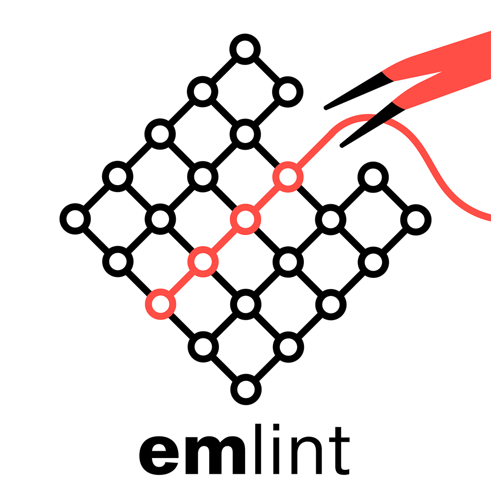

# emlint

<div align="center">
  <picture>
    <source media="(prefers-color-scheme: dark)" srcset="https://raw.githubusercontent.com/MathysRennela/emlint/main/docs/images/emlint_logo_with_name-dark.png">
    
  </picture>
</div>

<p align="center">
  <a href="https://pypi.org/project/emlint/"></a>
  <a href="https://pypi.org/project/emlint/"></a>
  <a href="https://github.com/MathysRennela/emlint/actions/workflows/ci.yml"></a>
  <a href="https://codecov.io/gh/MathysRennela/emlint"></a>
  <a href="https://github.com/MathysRennela/emlint/tree/main/docs"></a>
  <a href="https://github.com/MathysRennela/emlint/blob/main/LICENSE"></a>
  <a href="https://github.com/MathysRennela/emlint/blob/main/CODE_OF_CONDUCT.md"></a>
  <a href="https://unitary.foundation"></a>
  <a href="http://discord.unitary.foundation"></a>
  <a href="https://pepy.tech/project/emlint"></a>
</p>

**stim simulates. sinter samples. emlint verifies.**

emlint is a static linter for [Stim](https://github.com/quantumlib/Stim)
Detector Error Models (DEMs). It finds structural problems before simulation.

## Why emlint?

- **Catch DEM bugs before the expensive simulation.** A silent DEM bug can
  inflate logical error rates and may not surface until 10⁶ simulation shots
  (≈45 min). emlint finds structural problems
  in milliseconds.
- **Counter-examples.** A failing check identifies the
  offending mechanism, detector, or observable, so you know where to look.
- **Severity that respects the stakes.** `error` findings are unconditional DEM
  bugs; `warning` findings are heuristic or intentional-pattern candidates you
  review before acting.
- **Agent- and CI-friendly.** Exit codes distinguish clean, error, warning, and
  unlintable input; JSON and SARIF output feed scripts and code-scanning tools.

## See it in action

A d=5 surface-code DEM with a missing detector connection
([`examples/buggy.dem`](examples/buggy.dem)):

```text
$ emlint check examples/buggy.dem
Detectors: 24  Observables: 1  Error mechanisms: 31
DEM-only analysis: findings do not establish circuit semantic correctness.

  ✓ detectability: All error mechanisms that flip observables also trigger detectors.
  ✗ [warning] sensitivity: 1 detector(s) are never triggered by any error mechanism.
        Counter-example: Detector(s) not triggered by any error mechanism: D17@(1,0,2)
        Hint: Hypothesis: a detector no mechanism ever triggers is either miswired or
        redundant. Expected shape: at least one mechanism per stabilizer check per
        round; look for a missing noise instruction on the gates feeding this detector,
        or a DETECTOR declared on a comparison that never receives a fault. Limit: a
        detector with a constant outcome (fires every shot, or never fires) also has no
        mechanism in the DEM, so it is indistinguishable from a dead detector here;
        check the reference sample before treating this as a wiring bug.
  ✓ observable_coverage: All declared observables are flipped by at least one error mechanism.
  ✓ probability_bounds: All error mechanism probabilities are finite and strictly positive.
  ✓ duplicates: No duplicate mechanism signatures found.
  ✓ correctability: Every syndrome maps to at most one distinct set of logical observables.
  ✓ null_mechanism: No mechanism has empty detector and observable support.
  ✓ high_probability_mechanisms: All mechanism probabilities are ≤ 0.3.
  ✗ [warning] connectivity: Decoding graph has 2 connected components.
        Counter-example: Component 1: [0, 1, 2, 3, 4, 5, 6, 7, 8, 9, 10, 11, 12, 13, 14,
        15, 16, 18, 19, 20, 21, 22, 23]; Component 2: [17]
  ✓ boundary_symmetry: Skipped: fewer than 2 logical observables (boundary symmetry requires ≥ 2).
```

After reconnecting `D17` to its neighbours
([`examples/fixed.dem`](examples/fixed.dem)), every check passes. The
counter-examples name the exact detector (`D17@(1,0,2)`) and the isolated
decoding-graph component (`[17]`), so the fix is localized. More generated
examples live in [`examples/`](examples/README.md).

> **v0.2 is preliminary.** The user-facing behavior is usable, but internal APIs
> and implementation details may change before v1.0.

## Quick start

Install emlint:

```bash
pip install emlint
```

Lint a DEM file or raw DEM text:

```bash
emlint check circuit.dem
emlint check 'error(0.01) D0 L0
detector D0'
```

A failing result includes a counter-example identifying the relevant mechanism,
detector, or observable. Select checks with `--only`/`--ignore`, or emit SARIF for
code-scanning tools:

```bash
emlint check circuit.dem --only detectability,sensitivity
emlint check circuit.dem --format sarif > emlint.sarif
```

emlint accepts several input forms:

| Starting point | Path |
|---|---|
| A `.dem` file on disk | `emlint check circuit.dem` or `emlint.check(pathlib.Path(...))` |
| Raw DEM text | `emlint check 'error(0.01) D0 L0\ndetector D0'` or `emlint.check("...")` |
| A Stim circuit / DEM | `emlint.check(circuit.detector_error_model())` |
| A `pathlib.Path` | `emlint.check(path)` |

Project defaults can be placed in `pyproject.toml` under `[tool.emlint]`. For
all command options, configuration examples, and exit codes, see the [CLI reference](docs/cli.md).

## Python

```python
import emlint
import stim

circuit = stim.Circuit.generated(
    "surface_code:rotated_memory_z",
    distance=3,
    rounds=3,
    after_clifford_depolarization=0.001,
)
report = emlint.check(circuit.detector_error_model())
print(emlint.format_text(report))
```

`emlint.check()` also accepts a raw DEM string or an explicit `pathlib.Path`.

## Documentation

| Guide | Use it for |
|---|---|
| [CLI reference](docs/cli.md) | Commands, options, output, and exit codes |
| [Agent integration guide](docs/agent-integration.md) | Running emlint in a coding-agent fix-loop: exit-code handling, JSON contract, context declaration |
| [Check catalog](docs/checks.md) | What the ten checks detect and how to interpret findings, plus the machine-readable output contract |
| [Debugging guide](docs/debugging.md) | Check-specific causes and investigation steps |
| [Formal grounding](docs/formal-grounding.md) | DEM vocabulary and formal properties |
| [v0.2 limitations](docs/limitations.md) | Scope, warnings, repeat blocks, and provisional behavior |
| [Changelog](CHANGELOG.md) | Version history and user-visible changes |

> **Note:** on DEMs produced with `decompose_errors=True`, the `duplicates`
> check (warning) may report mechanisms that share a detector signature after
> graphlike decomposition as "duplicates". This is expected decomposition
> output, not a concatenation bug. The `graphlike-decoder` profile requires an
> explicit decoder context for compatibility checks; it does not suppress this
> warning, which can still make a correct DEM exit with code 2. Use `--ignore duplicates`
> only when you deliberately want to skip this advisory check.

## Exit codes

| Code | Meaning |
|---:|---|
| `0` | All checks passed |
| `1` | At least one error-severity finding |
| `2` | Warnings only |
| `3` | Unlintable input (unreadable or unparseable) |

Treat exit code `3` as an input failure, not as findings: an agent loop that
parses the report on exit `3` would reason about a DEM that emlint never saw.

> **Epistemic boundary:** emlint analyzes DEMs only. Its findings establish
> structural properties of the DEM itself; they do not establish that the
> underlying circuit is semantically correct, nor that a decoder succeeds.
> Circuit-level verification (e.g. with `stim`) remains necessary.

## CI

For a minimal GitHub Actions setup, install emlint and run it on changed DEM
files:

```yaml
- name: Install emlint
  run: pip install emlint
- name: Lint DEM files
  run: find . -name "*.dem" -print0 | xargs -0 -r -n1 emlint check
```

For local commits, the repository includes a pre-commit hook configuration:

```bash
pip install pre-commit
pre-commit install
```

The hook runs `emlint check --severity error` on staged `.dem` files. Warning-only
findings remain non-blocking; input failures still return exit code `3`.

## Repository layout

| Path | Holds |
|---|---|
| `emlint/` | Package: checks, model, CLI, output formatters |
| `docs/` | MkDocs site (CLI, check catalog, debugging, agent integration, formal grounding) |
| `examples/` | Small DEM fixtures (`buggy.dem`, `fixed.dem`) |
| `tests/` | Test suite |

## Non-goals

emlint is deliberately a **DEM-level** linter. It does not:

- verify that the underlying circuit is semantically correct (use `stim`),
- replace a decoder or estimate logical error rates,
- judge whether a DEM is "good enough" for a given decoder beyond the
  structural checks listed in the catalog,
- or execute or simulate circuits.

Findings establish structural properties of the DEM itself; circuit-level
verification remains necessary.

## Citation

If you use emlint in your work, please cite the repository:

```bibtex
@software{rennela2026emlint,
  title        = {emlint: a static linter for Stim Detector Error Models},
  author       = {Mathys Rennela},
  year         = {2026},
  version      = {0.2.4},
  publisher    = {Mathys Rennela},
  url          = {https://github.com/MathysRennela/emlint},
  license      = {Apache-2.0}
}
```

## Contributing

See [CONTRIBUTING.md](CONTRIBUTING.md) for development setup, how to add a
check, test requirements, and quality gates.

## AI Acknowledgement

emlint is developed with AI assistance for scaffolding, test generation,
red-teaming, and documentation. All design decisions, technical content, and
final code are reviewed and owned by the maintainers.

## Funding

This project is funded by a [Mozilla Foundation](https://foundation.mozilla.org/)
fellowship and supported by the [Unitary Foundation](https://unitary.foundation/).

## License

Apache 2.0
